# 産業フェアしずおか2026 デジタルスタンプラリー

# システム・トラブル対応マニュアル

- **対象イベント**: 産業フェアしずおか2026（2026年11月28日(土)・29日(日) 両日とも 09:30〜16:00／ツインメッセ静岡）
- **使用システム**: RALLY（https://rallyapp.jp/）
- **作成日**: 2026年11月20日

> [!NOTE]
>
> - ※本書に掲載している画面・抽選券・パネルの画像は、本番デザイン確定等により**差し替わる可能性**があります。

---

## 目次

1. [システムの全体像（各種URL・管理画面ログイン情報・参加から抽選までの流れ）](#1-システムの全体像)
2. [事前設定（期間設定）](#2-事前設定管理画面)
3. [トラブル対応（症状別 T1〜T6）](#3-トラブル対応症状別)
4. [管理画面でできること・できないこと](#4-管理画面でできることできないこと)
5. [障害発生時の連絡（RALLYサポート）](#5-障害発生時の連絡rallyサポート)
6. [参照資料（公式ヘルプ・使い方マニュアル・FAQ）](#6-参照資料)
7. [付録1：抽選会場で確認する画像一覧（※画像は差し替わる可能性あり）](#付録1抽選会場で確認する画像一覧画像は差し替わる可能性あり)
8. [付録2：抽選受付 判定フローチャート（現場卓上・アルバイト用）](#付録2抽選受付-判定フローチャート現場卓上アルバイト用)

---

## 1. システムの全体像

### 1-1 システム構成・各種URL・管理画面ログイン情報

| 項目                               | URL・設定内容                                                         | 備考・用途                                                                   |
| :--------------------------------- | :-------------------------------------------------------------------- | :--------------------------------------------------------------------------- |
| **公開用URL（本番用）**            | **https://www.stamprally.net/ptqrmhnmbzavadaz**                       | 来場者がアクセスする本番URL（抽選会場のTOP遷移用QRもこのURL）                |
| **確認用URL（テスト用）**          | **https://s.rallyapp.jp/s/zjwrfv24ru8c3xbx4l4f**                      | **確認用URLで、簡易的にスタンプ取得〜特典表示の動作確認が可能**              |
| **管理画面URL**                    | **https://admin.rallyapp.jp/#/signin**                                | 運営事務局が設定・データ出力を行う管理画面                                   |
| **管理画面ログイン情報**           | **ID**：`sf.shizuoka2026@gmail.com` **パスワード**：`sfsap3132`    | 運営本部PCにて管理                                                           |
| **RALLY（来場者画面）**            | スマホの標準ブラウザで動くスタンプラリー画面（アプリ不要）            | 推奨：iPhone ＝ Safari ／ Android ＝ Google Chrome                           |
| **スポットパネル（QRコード）**     | 会場内5箇所（スポット1〜5）にパネルを配置（＋特設サイト案内用パネル） | **北館2（スポット1・2）・プロムナード2（スポット3・4）・南館1（スポット5）** |
| **クリア特典（応募フォーム連携）** | 特典名：**「アンケートに回答して抽選会に参加」**                                                      | スタンプ5個達成で「特典に応募する！」からGoogleフォームへ遷移                        |
| **Googleアンケート URL**           | **https://docs.google.com/forms/d/e/1FAIpQLSf6ykwKWo71LoruKKE7_6qg4OKW157sQrjYf9ntk-ezf5mcCg/viewform** | 来場者アンケート（抽選会場受付の「アンケート予備QRコード」もこのURL／抽選券画像配布） |

#### 📍 スタンプラリーのスポット配置場所（全5箇所）と会場マップ

|   スポット    |      エリア      | 配置場所                                 | サイトに表示されるスタンプ画像               |
| :-----------: | :--------------: | :--------------------------------------- | :------------------------------------------- |
| **スポット1** |     **北館**     | **フードコートと林業ゾーンの近く**       | 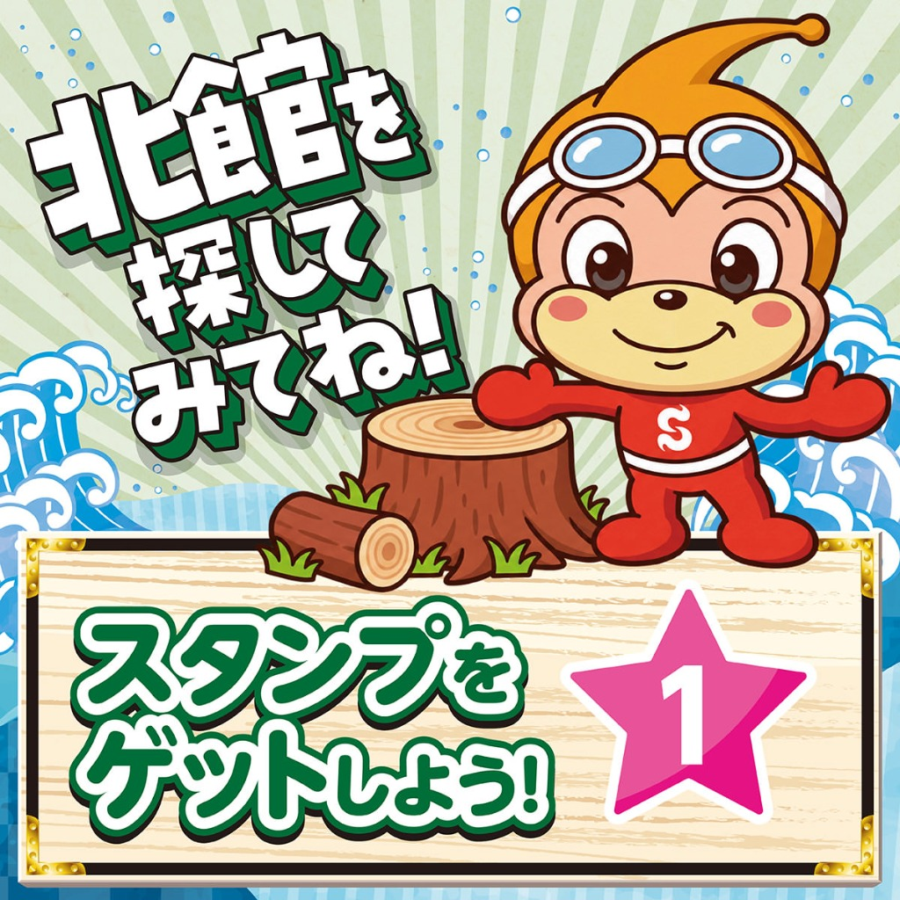 |
| **スポット2** |     **北館**     | **地場産業・観光ゾーン**                 | 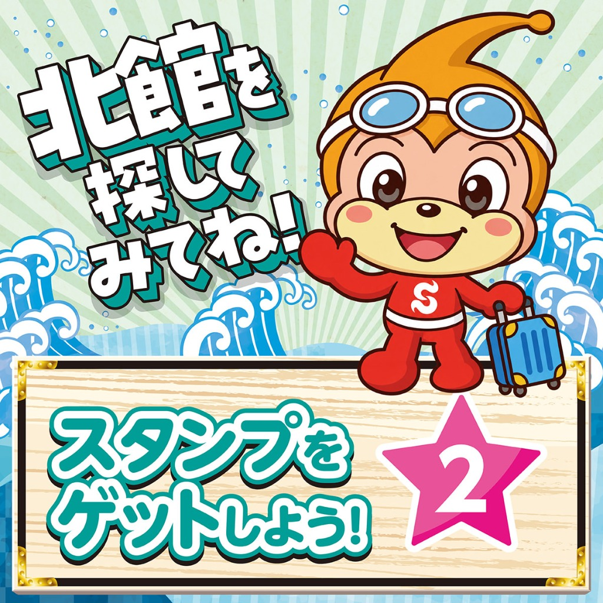 |
| **スポット3** | **プロムナード** | **プロムナード**                         | 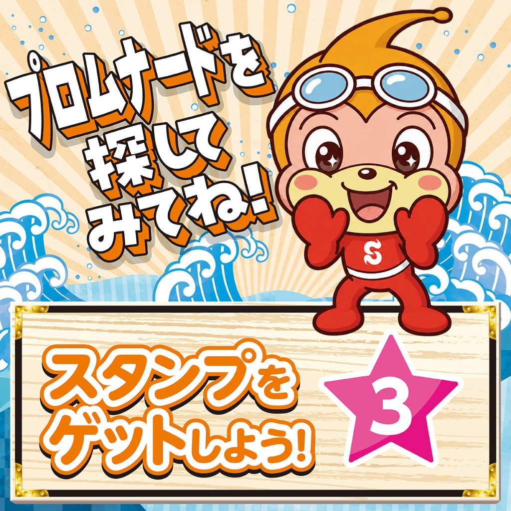 |
| **スポット4** | **プロムナード** | **プロムナード**                         | 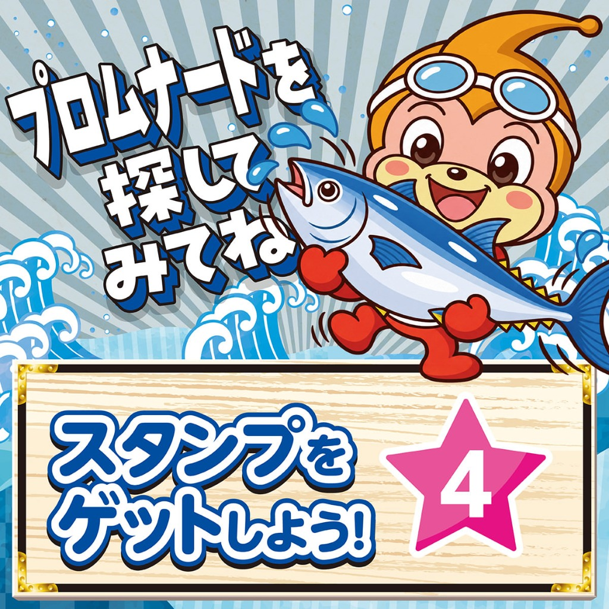 |
| **スポット5** |     **南館**     | **特別コーナー（商工会議所ゾーン近く）** | 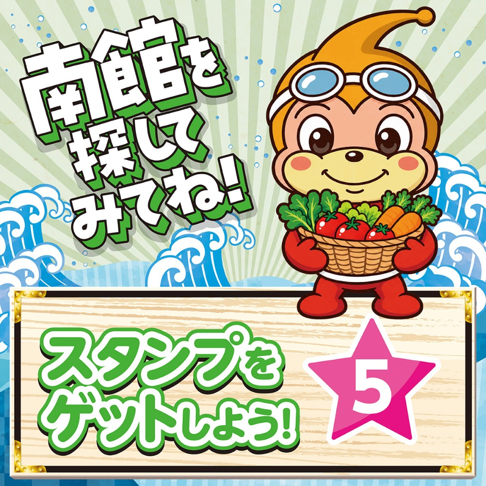 |

##### 🗺️ スタンプラリーの場所（会場マップ：★スタンプラリーポイント5箇所 ＋ 中央プロムナード「抽選会場」）

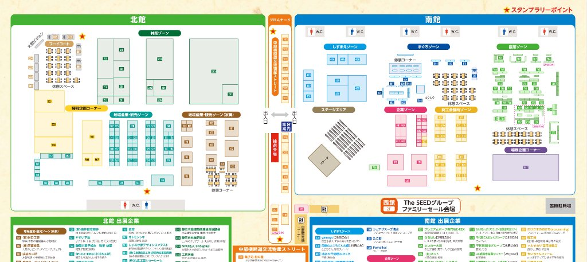

#### 🪧 会場内に配置するパネル（左：特設サイト案内用 ／ 右5体：スポット1〜5）

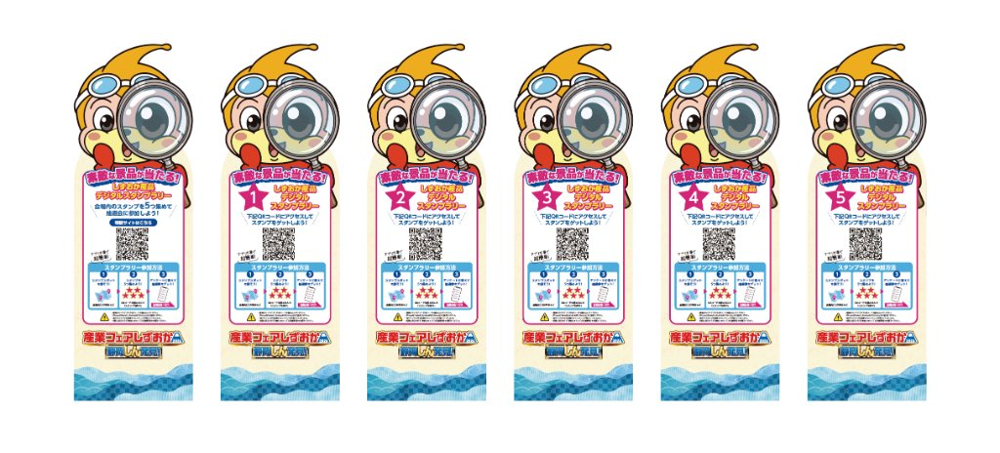

#### 🎫 抽選券の画像（`sangyofair2026抽選券.jpg`）

|        抽選券の画像（`sangyofair2026抽選券.jpg`）        | 備考                                                                                                                                                                                                                        |
| :------------------------------------------------------: | :-------------------------------------------------------------------------------------------------------------------------------------------------------------------------------------------------------------------------- |
| 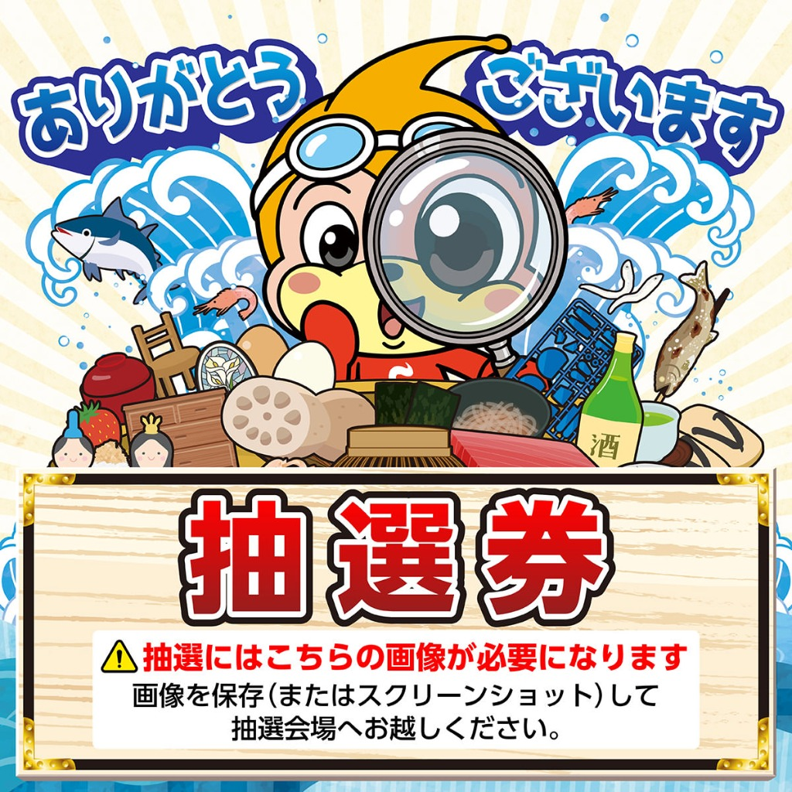 | アンケート内および送信完了画面（サンクスメッセージ）から表示・保存できる抽選券画像。 「⚠️抽選にはこちらの画像が必要になります 画像を保存（またはスクリーンショット）して抽選会場へお越しください。」と明記されています。 |

---

### 1-2 参加開始から抽選までの全体フロー

5箇所スタンプ達成からGoogleフォームアンケート回答、現地抽選会場での確認・景品手渡しまでの5ステップです。

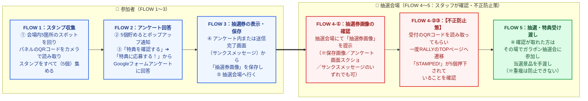

#### 📋 ステップ別の詳細（FLOW 1〜5）

|               区分               |                 ステップ                 | 内容                                                                                                                                                                                                                                                                                                                                                                          |
| :------------------------------: | :--------------------------------------: | :---------------------------------------------------------------------------------------------------------------------------------------------------------------------------------------------------------------------------------------------------------------------------------------------------------------------------------------------------------------------------- |
|            **参加者**            |        **FLOW 1** スタンプ収集        | ① 会場内の5箇所のスポット（スポット1〜5）を回り、配置されたパネルのQRコードをカメラで読み取り、スタンプをすべて（5個）集める。                                                                                                                                                                                                                                                |
|            **参加者**            |       **FLOW 2** アンケート回答       | ② 5個スタンプを貯めると、ポップアップで特典（「アンケートに回答して抽選会に参加」）を取得したことを通知。 ③ ポップアップされた「特典を確認する」をタップすると、抽選券を獲得するためのGoogleフォームにリンクするボタン（「特典に応募する！」）がタップできるようになる。                                                                                                   |
|            **参加者**            |     **FLOW 3** 抽選券の表示・保存     | ④ アンケート回答を進め、アンケート画面内、または送信完了画面（サンクスメッセージ＋画像表示用URL）から「抽選券の画像」を保存（またはスクリーンショット撮影）する。 ⑤ 抽選券の画像を取得した人は、抽選会場へ行く。                                                                                                                                                           |
| **抽選会場** （スタッフ確認） | **FLOW 4** 現地確認 【不正防止策】 | ① 抽選会場にて、「抽選券画像」をスタッフに提示する（※基本的には抽選券の画像で確認。保存画像・アンケート画面スクショ・サンクスメッセージのいずれでも可）。 ② **【不正防止策】** スタッフが画像確認後、受付のQRコードを読み取ってもらい、一度RALLYのTOPページへ遷移してもらう。 ③ TOPページにて、**「STAMPED!」が5個押下されていること（スタンプ獲得数5個）**を確認する。 |
| **抽選会場** （スタッフ確認） |     **FLOW 5** 抽選・特典受け渡し     | ④ 確認が取れた方は、その場でガラポン抽選会に参加し、当選景品を手渡しする。 ※重複は防止できない。                                                                                                                                                                                                                                                                           |

#### 📱 参加者の画面推移イメージ（※画像は差し替わる可能性があります）

|        ① 会場QRを読取・スタンプ収集        |            ② 5個取得でポップアップ表示            |       ③「特典を確認する」➔アンケートへ       |             ④ 抽選券画像を保存し抽選会場へ             |
| :----------------------------------------: | :-----------------------------------------------: | :------------------------------------------: | :----------------------------------------------------: |
| 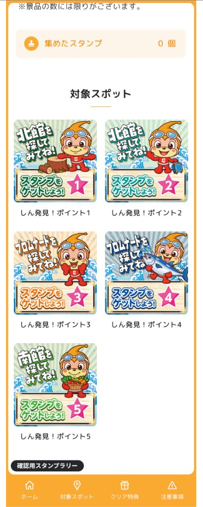 | 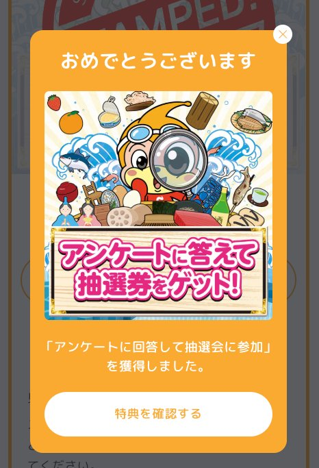 | 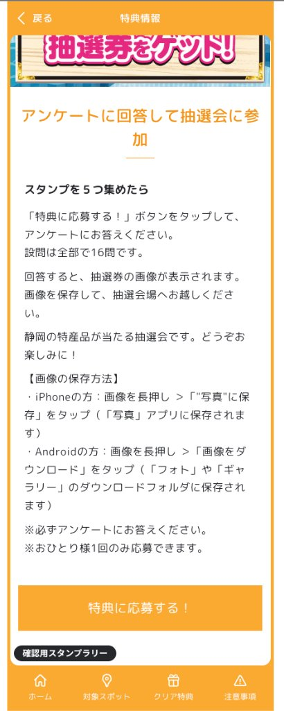 |  |

#### 🔍 抽選会場での不正防止確認フロー（※画像は差し替わる可能性があります）

|                 ① 抽選券画像を確認する                 | ② QRコードからスタンプラリーTOPへ遷移してもらう | ③ TOPページで「STAMPED!」が5個押下されていることを確認 |           ④ ガラポン抽選会に参加           |
| :----------------------------------------------------: | :---------------------------------------------: | :----------------------------------------------------: | :----------------------------------------: |
|  |    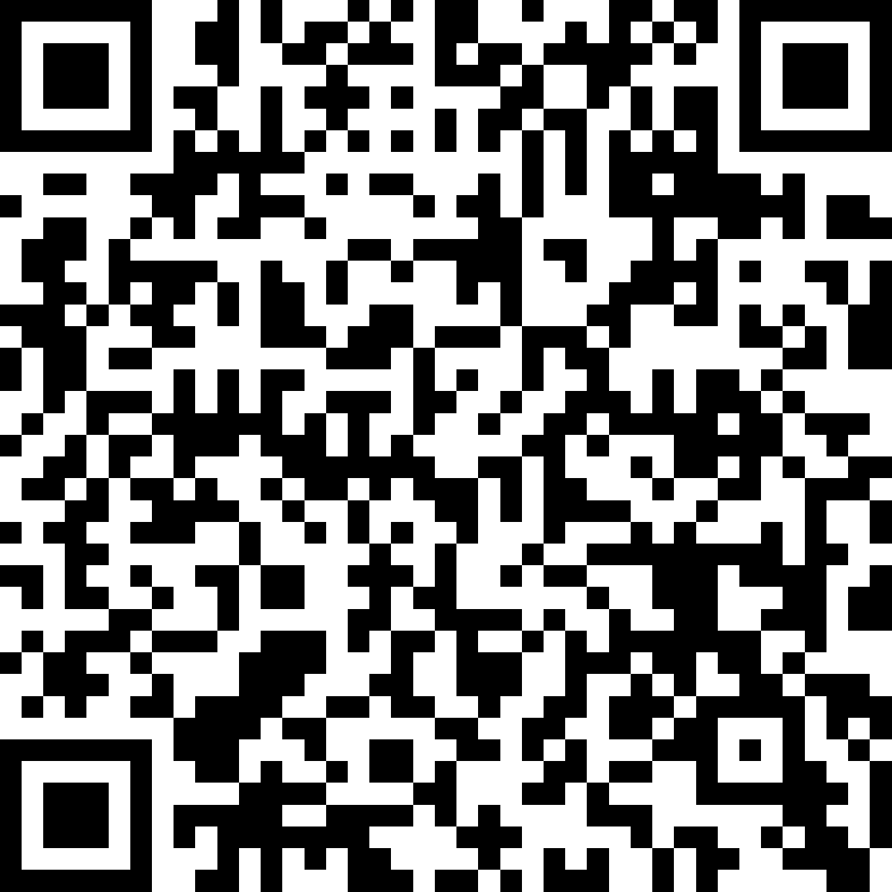    |     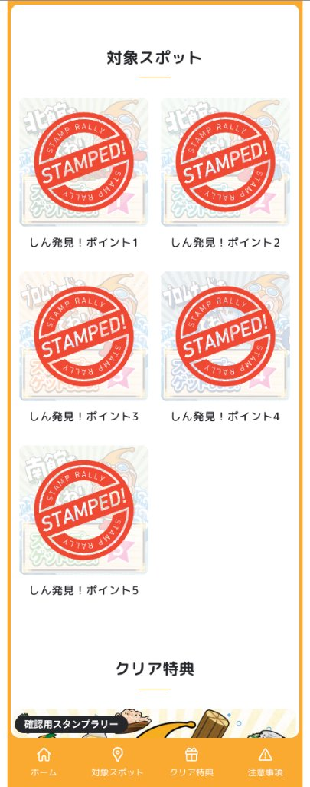      | 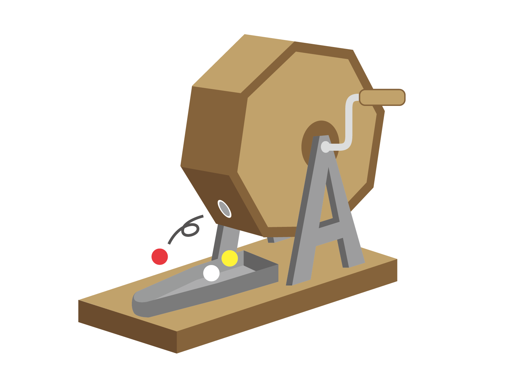 |

---

### 1-3 推奨環境とCookie仕様（トラブルを防ぐ基本知識）

- **推奨ブラウザ（標準ブラウザ必須）**:
  - **iPhone (iOS)**: **Safari**
  - **Android**: **Google Chrome**
- **スタンプが消えてしまう原因（非対応の環境）**:
  スタンプ獲得状況はスマホのブラウザ（Cookie）にのみ保存されます。以下の環境ではスタンプが保存されず消えてしまいます。
  1. **プライベート／シークレットモード**: ブラウザを閉じるとスタンプがすべて消えます。
  2. **LINE等のアプリ内ブラウザ**: LINEやSNS、QR専用アプリ内の画面で開くと、他スポットと合算されず消えてしまいます。
  3. **ブラウザの切り替え**: 1箇所目をSafari、2箇所目をChrome等で開くと別人と判定され合算されません。
  4. **Cookieブロック設定**: スマホ設定で「すべてのCookieをブロック」にしているとスタンプが押せません。

---

### 1-4 参加者数の上限（10万人枠を確保済み）

- 本イベントでは**「100,000人（10万人）枠」で契約・確保済み**のため、参加者数上限に達してスタンプが押せなくなる心配はありません。

---

## 2. 事前設定（管理画面）

### 2-1 期間設定の仕組み（3種類）

| 期間の種類             | 意味                                           | 期間が終わるとどうなるか                       |
| :--------------------- | :--------------------------------------------- | :--------------------------------------------- |
| **① 公開期間**         | スタンプラリーの画面を開ける期間               | **画面自体が開けなくなる**                     |
| **② スタンプ可能期間** | QRコードを読んでスタンプを押せる期間           | 画面は見られるが、**スタンプは押せなくなる**   |
| **③ 応募可能期間**     | 特典（「特典に応募する！」ボタン）を使える期間 | 画面は見られるが、**特典ボタンが押せなくなる** |

---

### 2-2 本イベントでの期間設定（両日とも 09:30〜16:00）

イベント開催時間は**11月28日(土)・29日(日)の両日とも 09:30〜16:00** です。  
1日目（土曜）の終了後に手作業で設定を止めると「翌朝の再開忘れ・設定ミス」のリスクがあるため、**2日間通しで設定し、29日(日) 16:00に自動終了**させます。

| 期間                 | 設定日時                                      | 設定のポイント                                                                        |
| :------------------- | :-------------------------------------------- | :------------------------------------------------------------------------------------ |
| **公開期間**         | **事前（11/27以前〜） 〜 11月29日(日) 17:00** | 当日朝のトラブルを防ぐため事前に公開。終了後も画面を見られるよう17:00まで開けておく。 |
| **スタンプ可能期間** | **11月28日(土) 09:30 〜 11月29日(日) 16:00**  | 2日間通し設定。29日(日) 16:00に自動でスタンプ取得が終了。                             |
| **応募可能期間**     | **11月28日(土) 09:30 〜 11月29日(日) 16:00**  | 2日間通し設定。29日(日) 16:00に自動で特典応募が終了。                                 |

---

## 3. トラブル対応（症状別）

### 一覧

|  No.   | よくある症状                           | 主な原因               | 対応する場所         | 対応の方針                                                                     |
| :----: | :------------------------------------- | :--------------------- | :------------------- | :----------------------------------------------------------------------------- |
| **T1** | スタンプが押せない・エラーが出る       | 電波不良               | 各スポット／抽選会場 | 電波の良い場所で再読取を案内                                                   |
| **T2** | 「特典に応募済」だがアンケート未回答   | リンクを押しただけ     | 抽選会場受付         | 受付卓の「アンケート予備QRコード」からその場で回答してもらう                   |
| **T3** | 抽選券画像を保存し忘れた・画面を閉じた | タブを閉じた・保存忘れ | 抽選会場受付         | TOPページの「STAMPED! 5個」＋クリア特典ページの「特典に応募済」の2点を確認する |
| **T4** | 「特典に応募する！」が押せない         | スタンプが5個未満      | 各スポット／抽選会場 | スタンプ一覧画面を見て、未獲得のスポットを再度見つけてもらうよう案内する       |
| **T5** | 画面が開かない・表示されない           | LINE内ブラウザ・設定等 | 各スポット／抽選会場 | 標準ブラウザ（Safari/Chrome）への切り替え等を案内                              |
| **T6** | システム全体が動かない                 | システム・通信障害     | 運営本部 ➔ RALLY     | 運営本部からRALLYサポートへ連絡                                                |

---

### T1. スタンプが押せない・エラーメッセージが出る

- **システムの仕組み**:
  - 電波が悪い状態でボタンを押すとエラーになり、スタンプは付きません。電波が戻ったあとに画面を**更新（リロード）してもスタンプは付かない**ため、もう一度QRコードを読み取る必要があります。
- **スタッフの案内方法（2つの場面に分けて案内）**:
  1. **【場面A：スポットのパネルの前で「押せない」と言われた場合】**
     - 「電波が届きにくい可能性があります。会場の無料Wi-Fiをご利用いただくか、少し移動して電波が入る状態で、**その場でもう一度パネルのQRコードを読み取ってください**」と案内します。
  2. **【場面B：抽選会場でTOPページを見たら「スタンプが4個以下（足りない）」だった場合】**
     - 「恐れ入りますが、まだ『STAMPED!』になっていない未獲得のスポットを会場内で再度見つけていただき、パネルのQRコードを読み取ってください」と案内します。

---

### T2. 特典ボタンが「特典に応募済」になっているが、アンケートに回答していない

- **原因**: 「特典に応募する！」を押してフォームを開いた瞬間に「特典に応募済」に変わる仕様のため、途中で画面を閉じると未回答のまま抽選券画像を持っていない状態になります。
- **対処**: 抽選会場の受付に置いてある**「アンケート予備QRコード」**を読み取ってもらい、その場でアンケートに回答・抽選券画像を表示してもらってから抽選へ案内します。

---

### T3. アンケートには答えたが、抽選券画像を保存し忘れたまま画面を閉じてしまった

- **現場の手順**:
  1. まず「アンケート送信後のサンクスメッセージ画面（タブ）が残っていないか」「写真フォルダ／ダウンロードフォルダに画像が入っていないか」を一緒に確認します（サンクスメッセージが残っていれば、記載のGoogleドライブURLからその場で画像を表示できます）。
  2. タブも閉じてしまい画像もない場合は、受付のQRコードからRALLYを開いてもらい、**①TOPページで「STAMPED! が5個揃っていること」＋ ②クリア特典ページで「特典に応募済」になっていること**の2点を確認します。

---

### T4. 「特典に応募する！」ボタンが押せない

- **原因**: スタンプがまだ5個集まっていません（4個以下）。
- **対処**: 対象スポット一覧画面を一緒に見て、まだ赤い「STAMPED!」が付いていない未獲得のスポットを確認し、会場内で再度見つけてパネルのQRコードを読み取ってもらうよう案内します。

---

### T5. 画面が開かない・表示されない・エラーになる

| 原因                                     | 対処方法                                                                                                                |
| :--------------------------------------- | :---------------------------------------------------------------------------------------------------------------------- |
| **LINE等のアプリ内ブラウザで開いている** | 画面右上（または右下）のメニュー「…」から**「Safariで開く」または「ブラウザで開く」**を選んで標準ブラウザに切り替える。 |
| **シークレットモードになっている**       | 通常のブラウザ画面（白いタブ）を開き直してQRコードを読み取る。                                                          |
| **Cookieがブロックされている**           | スマホの「設定」アプリからSafari／ChromeのCookieブロックを解除する。                                                    |
| **開催時間外**                           | 開始前（11/28 09:30前）や終了後（11/29 16:00以降）はスタンプや特典ボタンは押せません。                                  |

---

### T6. システム全体が動かない（全員がスタンプを押せない等）

→ **5. 障害発生時の連絡（RALLYサポート）** へ進み、運営本部へ連絡します。

---

## 4. 管理画面でできること・できないこと

| 管理画面での操作                                   | 可否  | 備考・現場での対応                                                     |
| :------------------------------------------------- | :---: | :--------------------------------------------------------------------- |
| 期間（公開・スタンプ・応募）を日時で設定する       |   ○   | それぞれ1つの期間（開始〜終了）を設定可能                              |
| 1日目と2日目で別々に期間を設定する                 |   ×   | できないため「2日間通し」で設定する                                    |
| 参加者へスタンプを手作業で付与する                 |   ○   | 手間が大きく混乱するため行わない（RALLYも非推奨）                      |
| 特典（アンケート遷移）の応募者データをDLする       |   ○   | 応募者ID・応募日時をCSVでダウンロード可能                              |
| 全体の集計データ（参加者数・スタンプ数等）をDLする |   ○   | イベント終了後にCSVでダウンロード可能                                  |
| **実際のガラポン抽選実施回数をシステム上で見る**   | **×** | **抽選会場の手動カウンター（数取器）や景品集計表で実数をカウントする** |

---

## 5. 障害発生時の連絡（RALLYサポート）

- **お問い合わせフォーム（推奨）**: RALLYサービスサイトの「お問い合わせフォーム」から送信（※電話窓口はありませんが、システム障害時は休日でもエンジニアチームへ自動通知されます）。
- **メール**: `support@rallyapp.jp`

---

## 6. 参照資料

| 資料名                                       | URL・ファイル                                  |
| :------------------------------------------- | :--------------------------------------------- |
| **システム ヘルプサイト（RALLY公式ヘルプ）** | **https://rallyapp.jp/help**                   |
| **RALLYのつかい方（マニュアル一覧）**        | **https://rallyapp.jp/help/categories/manual** |
| **よくあるご質問（FAQ一覧）**                | **https://rallyapp.jp/help/categories/faq**    |
| 特典応募の流れ（応募フォーム連携）           | https://rallyapp.jp/help/articles/a94lgt6qtm3v |
| 実施データダウンロード（CSV）                | https://rallyapp.jp/help/articles/vc1lm7mcpa51 |

---

## 付録1：抽選会場で確認する画像一覧（※画像は差し替わる可能性あり）

抽選会場では、**基本的には「抽選券の画像」で確認**します。  
アンケート内、またはサンクスメッセージから抽選券画像の表示・保存が可能なため、参加者が以下の**いずれかの画面を提示すれば確認OK**とします（※デザイン修正等により**画像は差し替わる可能性**があります）。

|     ①【抽選券】の画像（`sangyofair2026抽選券.jpg`）      |   ②【抽選券】スクリーンショット（アンケート画面内）    |  ③【アンケート】サンクスメッセージ（URLから画像表示も可）  |
| :------------------------------------------------------: | :----------------------------------------------------: | :--------------------------------------------------------: |
|  | 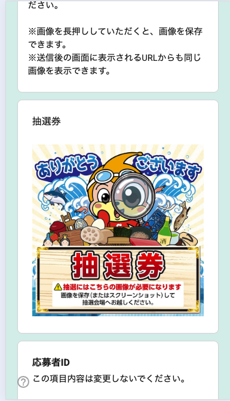 | 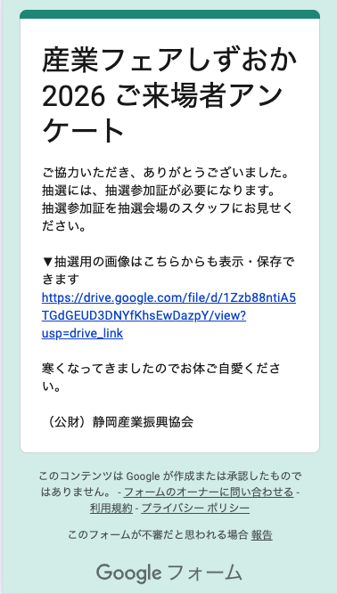 |

---

## 付録2：抽選受付 判定フローチャート（現場卓上・アルバイト用）

抽選会場の受付テーブルにラミネートして置いておく、アルバイトスタッフ向けの判断チャートです。

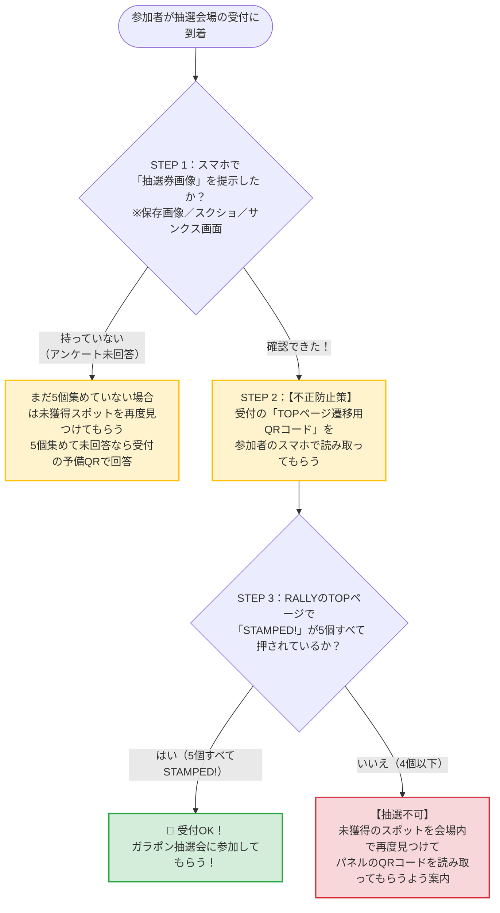
